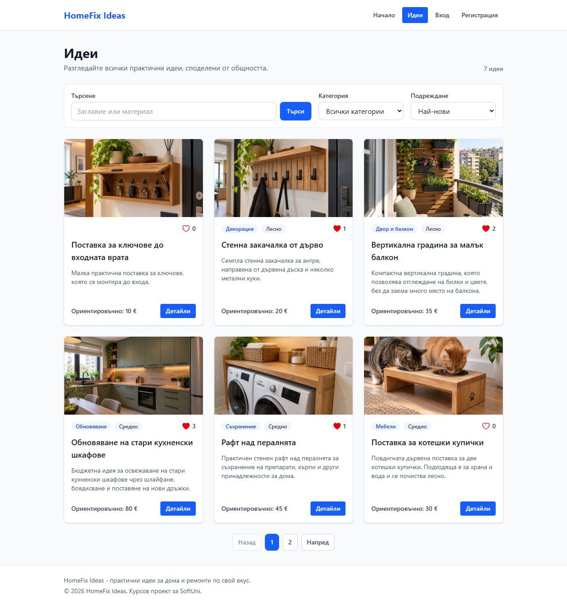
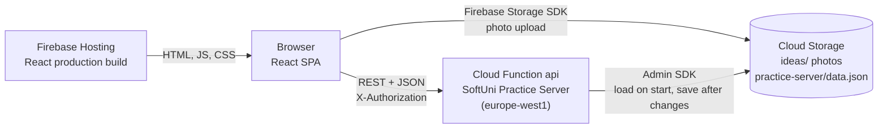

# HomeFix Ideas

A single page application for browsing and sharing practical home improvement and DIY ideas. Guests browse the catalog, and registered users publish their own ideas with a photo, like ideas and leave comments.

| | |
|---|---|
| **Live application** | **https://homefix-ideas-app.web.app** |
| **REST API (backend)** | https://api-l6them7dlq-ew.a.run.app (for example [`/data/ideas`](https://api-l6them7dlq-ew.a.run.app/data/ideas)) |
| **Source code** | https://github.com/ValeriCodeU/homefix-ideas |
| **Course** | SoftUni ReactJS, Retake Exam project (November 2026) |

The user interface is in Bulgarian. In this document, UI labels are quoted in Bulgarian, followed by an English translation the first time they appear.

## Quick start for reviewers

Open https://homefix-ideas-app.web.app. Nothing needs to be installed.

| Demo account | Password | Owns |
|---|---|---|
| `peter@abv.bg` | `123456` | 4 ideas, has liked 1 idea of john |
| `john@abv.bg` | `123456` | 3 ideas, has liked 2 ideas of peter |

You can also register a new account. All data is saved permanently (see [Data persistence](#data-persistence)). Because of that, please delete only ideas that you created yourself, so the demo data stays the same for other reviewers.

A short tour that covers the main requirements:

1. **As a guest**, open „Идеи“ (Ideas). Try the search (for example `рафт`), the category filter and the sorting by „Най-харесвани“ (Most liked), move to page 2 and open an idea. Then open `/ideas/create` directly: you are redirected to the login page.
2. **Log in as `peter@abv.bg`**. The header now shows „Добави идея“ (Add idea), „Моите идеи“ (My ideas), „Любими“ (Favorites) and a user menu. Opening `/login` now redirects to the home page.
3. Open „Органайзер за кабели под бюрото“, an idea of peter. Peter sees „Редактирай“ (Edit) and „Изтрий“ (Delete) and no like button, because authors cannot like their own ideas.
4. Open „Обновяване на стари кухненски шкафове“, an idea of john. The button shows „Харесано“ (Liked). Click it to remove the like, click it again, and add a comment.
5. Use „Добави идея“ to create an idea with a photo. Then edit it, and finally delete it after the confirmation dialog.
6. Open „Моите идеи“ and „Любими“, then log out from the user menu („Изход“).

> **Cold start:** the backend is a Cloud Function that scales to zero when nobody uses it. The first request after a quiet period can take a few seconds. The pages show loading states during that time.

## Screenshots

| Home page | Catalog with search, filter, sorting and pages |
|---|---|
|  |  |
| **Idea details with likes and comments** | **Mobile view (filtered catalog)** |
|  |  |

## Contents

- [Features](#features)
- [Tech stack](#tech-stack)
- [Getting started](#getting-started)
- [Functional Guide](#functional-guide)
- [Architecture](#architecture)
- [Requirements coverage](#requirements-coverage)
- [Deployment](#deployment)
- [Known limitations](#known-limitations)

## Features

- Public home page with the latest ideas and links to the six categories
- Public catalog with search, category filter, sorting and pagination, all stored in the URL
- Public details page with photo, cost, materials, description, likes and comments
- Registration, login and logout. The session survives a page refresh
- Create, edit and delete ideas. Only the author can edit or delete an idea
- Photo upload to Cloud Storage with type and size validation and a preview
- Likes (like and unlike) and comments for logged-in users
- „Моите идеи“ (My ideas): profile card and the user's own ideas
- „Любими“ (Favorites): the ideas the user has liked, most recently liked first
- Route guards for private and guest-only pages, and a 404 page
- Form validation with messages in Bulgarian, and loading, error and empty states on every page
- Responsive layout for mobile, tablet and desktop

## Tech stack

| Area | Technology |
|---|---|
| UI | React 19 (function components and hooks), JavaScript (JSX) |
| Build tool | Vite 8 |
| Routing | React Router 8 (`BrowserRouter`) |
| Global state | React Context API (`AuthContext`) |
| Forms | react-hook-form 7 |
| Styling | Tailwind CSS 4 through an external stylesheet ([src/index.css](src/index.css)) |
| Dialogs | SweetAlert2 (error messages and delete confirmation) |
| Backend | SoftUni Practice Server (Node.js REST API) as a Cloud Function for Firebase, 2nd gen |
| File storage | Cloud Storage for Firebase (idea photos and the saved server data) |
| Hosting and CI/CD | Firebase Hosting, deployed by GitHub Actions |
| Code quality | ESLint 10 (flat config) |

## Getting started

### Prerequisites

- [Node.js](https://nodejs.org/) 24 (the version used in development and in CI)
- Git

For the full local environment (option B) you also need:

- [Firebase CLI](https://firebase.google.com/docs/cli): `npm install -g firebase-tools`
- Java JDK 21 or newer (required by the Cloud Storage emulator)

### Option A: run the React app against the deployed backend (fastest)

```bash
git clone https://github.com/ValeriCodeU/homefix-ideas.git
cd homefix-ideas
npm install
npm run build
npm run preview
```

Open http://localhost:4173. The production build uses the deployed API and the real Cloud Storage bucket, so you see the same data as on the live site. Changes you make there are saved on the live backend.

### Option B: full local environment with the Firebase emulators

```bash
git clone https://github.com/ValeriCodeU/homefix-ideas.git
cd homefix-ideas
npm install
cd functions && npm install && cd ..
```

Then start two terminals in the project root:

```bash
npm run server   # terminal 1: Functions emulator (Practice Server) + Storage emulator
npm run dev      # terminal 2: Vite dev server
```

Open http://localhost:5173. The Emulator UI is at http://127.0.0.1:4000, and its Storage tab shows the uploaded photos. Local data starts from the seed data every time the emulators start. The same two demo accounts exist.

> **Troubleshooting:** if the emulator prints `Timeout after 10000`, Node.js loaded `firebase-functions` too slowly (this happens on some Windows machines). Start it with a longer limit:
> PowerShell: `$env:FUNCTIONS_DISCOVERY_TIMEOUT=30; npm run server`. Bash: `FUNCTIONS_DISCOVERY_TIMEOUT=30 npm run server`.

### npm scripts

| Script | What it does |
|---|---|
| `npm run dev` | Vite dev server, uses `.env.development` (local emulator API) |
| `npm run server` | Firebase emulators for the API and Cloud Storage |
| `npm run build` | Production build into `dist/`, uses `.env.production` (deployed API) |
| `npm run preview` | Serves `dist/` on http://localhost:4173 |
| `npm run lint` | ESLint for the React code |
| `npm run deploy:server` | Deploys the Cloud Function (backend) |
| `npm run deploy:client` | Builds and deploys the frontend to Firebase Hosting |
| `npm run deploy:rules` | Deploys the Cloud Storage security rules |

### Environment variables

No setup is needed. The two committed files contain only public URLs:

| File | `VITE_APP_SERVER_URL` |
|---|---|
| `.env.development` | `http://127.0.0.1:5001/homefix-ideas-app/europe-west1/api` (emulator) |
| `.env.production` | `https://api-l6them7dlq-ew.a.run.app` (deployed API) |

Every service builds its URLs from this variable, for example `${SERVER_URL}/data/ideas`. The Firebase web config in [src/firebase.js](src/firebase.js) is public by design. Access to files is controlled by [storage.rules](storage.rules).

---

## Functional Guide

### 1. Project Overview

**Application Name:** HomeFix Ideas

**Application Category / Topic:** community catalog for sharing home improvement and DIY ideas. It is a blog-like system with social features (likes, comments, favorites).

**Main Purpose:** HomeFix Ideas collects small, practical projects for the home in one place: organizers, shelves, renovation tips, balcony gardens. Each idea shows a photo, difficulty, estimated cost, required materials and a description. Visitors can quickly find an idea that fits their budget and skills. Registered users share their own ideas, save the ones they like and discuss them in the comments.

### 2. User Access & Permissions

#### Guest (Not Authenticated)

- **Available pages / routes:** home page `/`, catalog `/ideas` (with search, filter, sorting and pages), idea details `/ideas/:ideaId`, login `/login`, register `/register`, and the 404 page for any unknown URL.
- **Public data shown:** all ideas with photo, category, difficulty, estimated cost, materials and description, the number of likes, and all comments with the author's name and date.
- On the details page, guests see „Влезте, за да харесате“ (Log in to like) and „Влезте в профила си, за да коментирате“ (Log in to comment) instead of the buttons and the comment form.
- Opening a private URL (for example `/ideas/create`) redirects to `/login`.

#### Authenticated User

- **Main sections / pages:** „Начало“ (Home), „Идеи“ (Ideas), „Добави идея“ (Add idea, `/ideas/create`), „Моите идеи“ (My ideas, `/my-ideas`), „Любими“ (Favorites, `/favorites`), and a user menu with the e-mail and „Изход“ (Log out).
- **Details pages:** the same details page, plus the „Харесай“ / „Харесано“ (Like / Liked) button on other users' ideas and the comment form.
- **Create / Edit / Delete actions:**
  - Every logged-in user can create ideas.
  - Only the author sees „Редактирай“ (Edit) and „Изтрий“ (Delete). The edit page also checks the owner: another user who opens `/ideas/:ideaId/edit` is redirected to the details page. The server enforces the same rule and answers `403` to anyone else.
  - Users can like other users' ideas, remove their like, and comment on any idea. Authors can comment on their own ideas, and their comments get the badge „Автор“ (Author).
- Logged-in users cannot open `/login` or `/register`. They are redirected to the home page.

### 3. Authentication & Session Handling

#### Authentication Flow

1. **When the app loads:** [AuthProvider](src/contexts/AuthContext.jsx) wraps all routes in [App.jsx](src/App.jsx). Its `user` state comes from the custom hook [useLocalStorage](src/hooks/useLocalStorage.js). The hook's lazy initializer reads the `user` key from `localStorage` before the first render.
2. **How authentication status is checked:** the context exposes `isAuthenticated = !!user?.accessToken`. The header, the route guards and the pages read it with `useContext(AuthContext)`. The token itself is checked by the server on every request that sends it.
3. **On successful login or registration:**
   - The form is validated.
   - `loginHandler` / `registerHandler` calls `POST /users/login` or `POST /users/register`.
   - The response holds the user and an `accessToken`. The app stores `{ _id, email, accessToken }` in state and in `localStorage`.
   - The user is sent to the home page, and the header immediately shows the private links.
   - Wrong credentials or an e-mail that is already registered show an error dialog. The user stays on the form.
4. **On logout:**
   - The user menu calls `GET /users/logout` with the `X-Authorization` header. Errors are ignored, because the session may already be invalid.
   - The app clears the state and `localStorage` and navigates to the home page.
5. **Invalid session:** if a request with the token returns `403 Invalid access token`, `sessionExpiredHandler` logs the user out, opens `/login` and shows the message „Сесията изтече“ (The session has expired).

#### Session Persistence

- **Storage:** the session (`_id`, `email`, `accessToken`) is kept in React state inside `AuthContext` and mirrored to `localStorage` under the key `user` by `useLocalStorage`.
- **Automatic login after refresh:** the initial state is read from `localStorage` synchronously. The first render already has the user, so the guards do not redirect and the page does not flicker. Sessions are also stored on the backend (see [Data persistence](#data-persistence)), so a token stays valid until logout.

### 4. Routing Structure

#### Route Guards Logic

Routes are defined in [App.jsx](src/App.jsx). Two pathless layout routes split them:

- [GuestRoute](src/components/guards/GuestRoute.jsx) wraps `/login` and `/register`. It renders `<Outlet />` for guests and `<Navigate to="/" replace />` for logged-in users.
- [PrivateRoute](src/components/guards/PrivateRoute.jsx) wraps `/ideas/create`, `/ideas/:ideaId/edit`, `/my-ideas` and `/favorites`. It renders `<Outlet />` for logged-in users and `<Navigate to="/login" replace />` for guests.

#### Main Routes

10 page routes inside one layout route: 3 public pages, 2 guest-only pages, 4 private pages and the 404 page.

| Path | Page component | Access |
|---|---|---|
| `/` | [Home](src/components/home/Home.jsx) | public |
| `/ideas` | [IdeasCatalog](src/components/ideas-catalog/IdeasCatalog.jsx) | public |
| `/ideas/:ideaId` | [IdeaDetails](src/components/idea-details/IdeaDetails.jsx) | public |
| `/login` | [Login](src/components/login/Login.jsx) | guests only |
| `/register` | [Register](src/components/register/Register.jsx) | guests only |
| `/ideas/create` | [IdeaCreate](src/components/idea-create/IdeaCreate.jsx) | logged in |
| `/ideas/:ideaId/edit` | [IdeaEdit](src/components/idea-edit/IdeaEdit.jsx) | logged in, author only |
| `/my-ideas` | [MyIdeas](src/components/my-ideas/MyIdeas.jsx) | logged in |
| `/favorites` | [FavoriteIdeas](src/components/favorite-ideas/FavoriteIdeas.jsx) | logged in |
| `*` | [NotFound](src/components/not-found/NotFound.jsx) | public |

#### Nested & Parameterized Routes

- **Nested routing:** yes. All pages are children of a layout route `<Route element={<Layout />}>`. [Layout](src/components/layout/Layout.jsx) renders the header, the page in `<Outlet />` and the footer. The two guards are nested layout routes inside it.
- **URL parameters:** `/ideas/:ideaId` and `/ideas/:ideaId/edit`. Both read the id with `useParams()`.
- **Query parameters:** the catalog, „Моите идеи“ and „Любими“ keep their state in the URL with `useSearchParams()`: `?category=Storage&q=рафт&sort=likes&page=2`. A filtered list can be bookmarked or shared, and it survives a refresh and the Back button.

### 5. List → Details Flow

#### Catalog / List Page

- **What data is displayed:** every idea is a card ([IdeaCard](src/components/idea-card/IdeaCard.jsx)) with the photo, or a placeholder when there is none. The card also shows the category and difficulty badges, the number of likes, the title, a short description, the estimated cost and a „Детайли“ (Details) button. The catalog shows 6 ideas per page and the total number of matching ideas.
- **How the user interacts with the list:**
  - **Search** in the title and the materials, started with Enter or „Търси“ (Search).
  - **Filter** by one of six categories. The category cards on the home page open the catalog already filtered.
  - **Sort** by „Най-нови“ (Newest) or „Най-харесвани“ (Most liked). „Любими“ adds „Последно харесани“ (Recently liked).
  - **Pagination** with „Назад“ (Previous), page numbers and „Напред“ (Next).
  - „Изчисти филтрите“ (Clear filters) resets the list.
- Filtering, sorting and paging run in the browser in the custom hook [useIdeaFilters](src/hooks/useIdeaFilters.js), using pure functions from [ideaQuery.js](src/utils/ideaQuery.js). They are calculated from the loaded ideas and the URL on every render, without extra state. Most liked needs the like count, which lives in a separate collection. The page therefore loads ideas and likes in parallel (`Promise.all`) and counts the likes per idea.

#### Details Page

- **How navigation is triggered:**
  - The „Детайли“ button is a `<Link to={`/ideas/${_id}`}>`. It also passes the current list URL in the link state, so „← Назад“ (Back) returns to the same filtered page.
  - `useNavigate()` is used after actions: after create or edit it opens the idea, and after delete it opens the catalog.
- **What data is received via route parameters:** `ideaId`. The page loads `GET /data/ideas/:ideaId`, the likes of the idea (`where=ideaId="..."`) and its comments with their authors (`load=author=_ownerId:users`). An unknown id shows „Идеята не съществува или не може да бъде заредена.“ (The idea does not exist or cannot be loaded).

### 6. Data Source & Backend

#### Backend Type

Real backend: the **SoftUni Practice Server** (Node.js REST API), deployed as a **Cloud Function for Firebase** (2nd gen HTTP function `api`, region `europe-west1`). Photos and the server data are stored in **Cloud Storage for Firebase**. The SoftUni Training Team confirmed that the Practice Server is an acceptable backend when it is deployed and publicly reachable.

- **API base URL:** `https://api-l6them7dlq-ew.a.run.app`
- **Authentication:** `POST /users/register` and `POST /users/login` return an `accessToken`. Requests that change data send it in the `X-Authorization` header.
- **Collections used by the frontend:**

| Collection | Fields | Used for |
|---|---|---|
| `ideas` | `title, category, difficulty, estimatedCost, materials, description, imageUrl` | the main CRUD collection |
| `likes` | `ideaId` | likes, like counts, favorites |
| `comments` | `ideaId, text` | comments on the details page |

System fields (`_id`, `_ownerId`, `_createdOn`, `_updatedOn`) are set by the server. `category` and `difficulty` store English values (`Organization`, `Easy`), and the UI shows Bulgarian labels from [ideaOptions.js](src/utils/ideaOptions.js).

- **Photos:** [imageService.js](src/services/imageService.js) uploads the file directly from the browser to Cloud Storage (`ideas/<uuid>.<ext>`). The idea stores only the download URL in `imageUrl`.

#### Data persistence

The Practice Server keeps its data in memory, and Cloud Run stops the instance when nobody uses it. To keep the data between visits, [functions/index.js](functions/index.js) adds a small persistence layer around the unchanged REST logic:

- **After every change** (register, login, logout, create, edit, delete, like, comment), the whole data set is saved as one JSON file in Cloud Storage (`practice-server/data.json`). The save happens before the response is sent. Saves run one after another, so an older copy never overwrites a newer one.
- **When a new instance starts**, it loads that file before it answers its first request. Ideas, likes, comments, registered users and sessions therefore survive restarts and redeployments.
- The file is not reachable from the browser, because [storage.rules](storage.rules) open only `ideas/`. Plain-text passwords are not written to it: the server checks only the password hash.

### 7. Data Operations (CRUD)

The `ideas` collection supports all four operations. All requests go through the service modules in [src/services](src/services) and the shared [request.js](src/services/request.js). `request.js` adds the JSON and `X-Authorization` headers and turns error responses into exceptions.

#### Create (POST)

- „Добави идея“ opens [IdeaCreate](src/components/idea-create/IdeaCreate.jsx), which renders the shared [IdeaForm](src/components/idea-form/IdeaForm.jsx).
- After validation, the selected photo, if any, is uploaded to Cloud Storage. Then `POST /data/ideas` sends the idea with the photo URL.
- A success dialog is shown, and the user is taken to the details page of the new idea.

#### Read (GET)

| Page | Request |
|---|---|
| Home | the 3 newest ideas: `sortBy=_createdOn desc&pageSize=3` |
| Catalog | all ideas and all likes in parallel, to show like counts and to sort by likes |
| Details | the idea by id, its likes, and its comments with authors |
| My ideas | `where=_ownerId="<user id>"`, newest first |
| Favorites | the user's likes, then `where=_id in (...)` for the liked ideas |

Data is loaded in `useEffect`, and every page has loading, error and empty states.

#### Update (PUT)

- **How the author edits:** the author clicks „Редактирай“ on the details page and opens `/ideas/:ideaId/edit`.
  - [IdeaEdit](src/components/idea-edit/IdeaEdit.jsx) loads the idea and checks that the current user is the owner.
  - It renders the same `IdeaForm` filled with the current values (`defaultValues` and `reset`) and the current photo.
  - A new photo is optional. Without one, the old `imageUrl` stays.
  - `PUT /data/ideas/:ideaId` saves the changes.
- **How the UI updates:** a success dialog is shown, and `navigate()` opens the details page. The page loads the updated idea when it mounts.

#### Delete

- **How the author deletes:** the author clicks „Изтрий“ on the details page. A SweetAlert2 dialog asks for confirmation („Сигурни ли сте?“ / „Да, изтрий“ / „Отказ“: Are you sure? / Yes, delete / Cancel). After confirmation, `DELETE /data/ideas/:ideaId` is sent.
- **How the UI updates:** a success dialog is shown, and the user is taken to the catalog. The catalog loads the list again, without the deleted idea.

#### Interaction with records

- **Likes:** `POST /data/likes { ideaId }` and `DELETE /data/likes/:id`. The button toggles and the count updates after the server confirms.
- **Comments:** `POST /data/comments { ideaId, text }`. The new comment appears at the top immediately (`useOptimistic`) with the text „Изпраща се…“ (Sending…). The server response then replaces it.
- Likes and comments are separate records that reference the idea by `ideaId`. Users never modify another user's idea.

### 8. Forms & Validation

#### Forms Used

- Login ([Login.jsx](src/components/login/Login.jsx))
- Register ([Register.jsx](src/components/register/Register.jsx))
- Create idea and Edit idea, one shared component ([IdeaForm.jsx](src/components/idea-form/IdeaForm.jsx))
- Comment form ([IdeaCommentCreate.jsx](src/components/idea-comment-create/IdeaCommentCreate.jsx))
- Search form and filter selects in the lists ([IdeaFilters.jsx](src/components/idea-filters/IdeaFilters.jsx))

#### Validation Rules

All rules are in [src/utils/validation.js](src/utils/validation.js). Messages are shown in Bulgarian under each field.

- **Email** (login, register): required, and it must match an e-mail pattern.
- **Password** (register): required, at least 6 characters. **Repeat password:** required, and it must equal the password.
- **Title** (idea), a field with multiple rules: required, at least 5 and at most 100 characters.
- **Estimated cost:** required, a number, not negative.
- **Category** and **Difficulty:** required selections.
- **Photo:** optional. It must be JPEG, PNG or WebP and smaller than 5 MB. It is checked as soon as a file is chosen, and a valid file shows a preview.
- **Materials:** required, 3–500 characters. **Description:** optional, 3–1000 characters.
- **Comment:** required, not only spaces, at most 500 characters.

How the forms work:

- **Library:** react-hook-form manages them.
- **Binding:** `register()` connects each input to the form state through React synthetic `onChange` and `onBlur` handlers. The filter selects in `IdeaFilters` are fully controlled inputs, with `value` taken from the URL and an `onChange` handler. Other synthetic events in use: `onSubmit`, `onClick` (like, delete, pagination, user menu) and a custom `onChange` for the photo input.
- **When fields are validated:** the login, register and idea forms use `mode: 'onTouched'`, which shows a field's error after the user leaves it. The comment form validates on submit, so an empty box that the user only clicks does not show an error. `noValidate` turns off the browser's English messages. Invalid fields get `aria-invalid` and a red border.
- **Duplicate submits:** the submit button is disabled while the request is pending.

### 9. React-Specific Techniques

#### Hooks & Component Lifecycle

| Hook | Where |
|---|---|
| `useState` | page data, loading and error flags, menu state, photo preview |
| `useEffect` | data loading on every page, document listeners in `UserMenu`, photo preview cleanup in `IdeaForm` |
| `useContext` | `AuthContext` in 11 components |
| `useRef` | `UserMenu` (closes the menu on a click outside) |
| `useOptimistic`, `startTransition`, `useTransition` | comments appear immediately, and the button shows „Публикуване…“ (Publishing…) |
| `useParams`, `useNavigate`, `useLocation`, `useSearchParams` | React Router: id from the URL, redirects after actions, the Back link, filters in the URL |
| `useForm` | react-hook-form in all forms |
| Custom hooks | [useLocalStorage](src/hooks/useLocalStorage.js) (state mirrored to `localStorage`), [useIdeaFilters](src/hooks/useIdeaFilters.js) (search, filter, sort and pages from the URL) |

**Mount / update / unmount example**, shortened from [IdeaDetails.jsx](src/components/idea-details/IdeaDetails.jsx):

```jsx
useEffect(() => {
    let ignore = false;

    ideaService.getById(ideaId)
        .then((result) => {
            if (ignore) return;
            setIdea(result);
        });
        // .catch(...) sets the error state, .finally(...) ends the loading state

    return () => {
        ignore = true;
    };
}, [ideaId]);
```

- **Mount:** the effect loads the idea.
- **Update:** when `ideaId` changes (another idea opened in the same component), the cleanup marks the old request as outdated and a new request starts.
- **Unmount:** when the user leaves the page, the cleanup runs, and a late response no longer updates the component.

Two more examples:

- [UserMenu](src/components/layout/UserMenu.jsx) adds `pointerdown` and `keydown` listeners to `document` while the menu is open, and removes them in the cleanup.
- [IdeaForm](src/components/idea-form/IdeaForm.jsx) frees the photo preview URL (`URL.revokeObjectURL`) when the photo changes or the form unmounts.

#### Context API

[AuthContext](src/contexts/AuthContext.jsx) shares `user`, `isAuthenticated`, `registerHandler`, `loginHandler`, `logoutHandler` and `sessionExpiredHandler`. It is consumed by:

- `Header` (links and user menu)
- `PrivateRoute` and `GuestRoute`
- `Login` and `Register`
- `IdeaCreate` and `IdeaEdit`
- `IdeaDetails` and `IdeaLikes`
- `MyIdeas` and `FavoriteIdeas`

#### Component Styling

- **Approach:** components are styled with **Tailwind CSS 4** utility classes, compiled from the external stylesheet [src/index.css](src/index.css).
- **The stylesheet:** it also holds base styles and the shared form classes (`.form-label`, `.form-field`) that every form uses.
- **Visual rules:**
  - a limited palette: blue for primary actions, slate for text and backgrounds, red for errors and likes;
  - hover, focus-visible, active and disabled states on all controls;
  - responsive grids with 1, 2 or 3 columns.

### 10. Typical User Flow

1. A visitor opens the home page, sees the latest ideas and clicks the category „Двор и балкон“ (Garden and balcony). The catalog opens already filtered.
2. The visitor opens an idea and reads the description, the likes and the comments. To like it, they click „Регистрация“ (Register) and create an account.
3. After registration they are logged in and back on the home page. They click „Добави идея“, fill in the form, choose a photo and save. The details page of the new idea opens.
4. They notice a typo, click „Редактирай“, fix it and save. The details page shows the change.
5. They open another user's idea, click „Харесай“ (Like) and write a comment. The idea now appears in „Любими“.
6. In „Моите идеи“ they see their idea. Later they delete it after the confirmation dialog, and log out from the user menu.

### 11. Error & Edge Case Handling

- **Authentication errors:**
  - Wrong e-mail or password (`403`) shows „Грешен имейл или парола.“ (Wrong e-mail or password).
  - An e-mail that is already registered (`409`) shows „Вече има регистриран потребител с този имейл.“ (A user with this e-mail already exists).
  - An invalid or expired token on any action logs the user out, opens `/login` and shows „Сесията изтече“.
  - Guards stop guests from opening private pages and users from opening the login and register pages.
- **Network or data errors:**
  - Every page that loads data shows a clear error message instead of crashing.
  - Failed actions (save, delete, like, comment, photo upload) show an error dialog. The form keeps its values, so the user can try again.
  - A failed photo upload stops the save, so no idea is saved with a broken image.
  - Submit buttons are disabled while a request is pending.
- **Empty or missing data states:**
  - Empty catalog, „Моите идеи“ and „Любими“ pages show a message and a call-to-action button.
  - A search with no results offers „Изчисти филтрите“.
  - An unknown category in the URL shows „Такава категория не съществува.“ (This category does not exist).
  - An invalid page number falls back to a valid page.
  - An idea without a photo shows a placeholder, and empty optional fields are hidden.
  - A missing idea shows a message, a discussion without comments invites the first comment, and unknown URLs show the 404 page.

---

## Architecture

### Overview



Inside the React app, data flows in one direction:

```text
page component (useEffect or submit handler)
  -> service module (ideaService, likeService, commentService, authService, imageService)
    -> request.js (fetch, JSON, X-Authorization, error object)
      -> REST API
```

State is kept at three levels:

- **Global:** the session in `AuthContext`.
- **Local:** each page's data and loading and error flags in `useState`.
- **URL:** filters and the current page in the query string.

### Project structure

```text
homefix-ideas/
├── src/                          # React application
│   ├── main.jsx                  # entry point, BrowserRouter
│   ├── App.jsx                   # AuthProvider and all routes
│   ├── index.css                 # Tailwind CSS, base styles, shared form classes
│   ├── firebase.js               # Firebase app and Storage (emulator in development)
│   ├── components/               # one kebab-case folder per component
│   │   ├── layout/               # Layout, Header, UserMenu, Footer
│   │   ├── guards/               # PrivateRoute, GuestRoute
│   │   ├── home/ ideas-catalog/ idea-details/ idea-create/ idea-edit/
│   │   ├── my-ideas/ favorite-ideas/ login/ register/ not-found/        # pages
│   │   ├── idea-form/ idea-card/ idea-list/ idea-filters/ pagination/   # reusable
│   │   ├── idea-likes/ idea-comment-create/ idea-comment-list/          # reusable
│   │   └── field-error/ heart-icon/ skeleton-card/                      # small UI parts
│   ├── contexts/                 # AuthContext
│   ├── hooks/                    # useLocalStorage, useIdeaFilters
│   ├── services/                 # request.js + one service per collection, imageService
│   └── utils/                    # validation rules, idea options, list helpers, formatting
├── functions/                    # backend: Cloud Function (separate Node.js project)
│   ├── index.js                  # HTTP function "api" and data persistence
│   └── server/server.js          # SoftUni Practice Server, adapted for Cloud Functions
├── docs/screenshots/             # images used in this README
├── storage.rules                 # Cloud Storage security rules
├── firebase.json                 # Hosting, Functions and Storage configuration
└── .github/workflows/            # GitHub Actions: deploy to Firebase Hosting
```

### Main design decisions

- **Pages stay thin:** `IdeaCreate` and `IdeaEdit` both render `IdeaForm`. Home, the catalog, „Моите идеи“ and „Любими“ all use `IdeaList`, which renders the four list states: loading skeleton, error, empty and cards.
- **One place for HTTP:** components never call `fetch` directly. Each collection has a service module, and all of them use `request.js`.
- **Likes and comments are separate collections.** Liking an idea creates a record of the current user and never changes the idea of another user.
- **List state lives in the URL** (`useSearchParams`). It survives a refresh, the Back button and sharing a link, and it needs no extra React state.
- **Every request with a token handles an expired session the same way** with `isInvalidTokenError()` and `sessionExpiredHandler()`.

## Requirements coverage

How the project meets the React Retake Exam specification:

| Requirement | Implementation |
|---|---|
| At least 3 dynamic pages | Home, Catalog, Details, My ideas, Favorites, Create, Edit |
| Client-side routing to 5+ pages, 2+ with URL parameters | 10 page routes in [App.jsx](src/App.jsx); `/ideas/:ideaId` and `/ideas/:ideaId/edit` |
| Catalog and Details views | `/ideas` and `/ideas/:ideaId` |
| Route guards | [PrivateRoute](src/components/guards/PrivateRoute.jsx), [GuestRoute](src/components/guards/GuestRoute.jsx), plus the owner check in [IdeaEdit](src/components/idea-edit/IdeaEdit.jsx) |
| Register, Login, Logout; identity shared across the app | [AuthContext](src/contexts/AuthContext.jsx) with `localStorage` persistence |
| Remote data, no hardcoded data | REST requests in [src/services](src/services) to the deployed Practice Server |
| Full CRUD on a non-user collection, only the author edits or deletes | `ideas`: create, read, update, delete; owner checks in the UI, on the edit route and on the server |
| Controlled forms and synthetic events | react-hook-form (`register` with `onChange` and `onBlur`), controlled selects in [IdeaFilters](src/components/idea-filters/IdeaFilters.jsx), `onSubmit` and `onClick` handlers |
| Validation and error handling | [validation.js](src/utils/validation.js), field messages, error dialogs, loading, error and empty states |
| User interaction | likes, comments, favorites |
| Hooks and lifecycle | see [Functional Guide, section 9](#9-react-specific-techniques) |
| Context API | `AuthContext` used by 11 components |
| Folder structure and external CSS | component folders in [src/components](src/components); styling in [src/index.css](src/index.css) |
| Documentation | this README |
| Deployed frontend and backend | Firebase Hosting and the Cloud Function `api`; data persists in Cloud Storage |
| Git history | public repository, more than 75 commits on more than 25 different days (July to November 2026) |

## Deployment

| Part | Where | How it is deployed |
|---|---|---|
| React app | Firebase Hosting, https://homefix-ideas-app.web.app | Automatically by GitHub Actions on every push to `main` |
| REST API | Cloud Function `api` (2nd gen, `europe-west1`, max 1 instance) | `npm run deploy:server` |
| Photos and server data | Cloud Storage bucket `homefix-ideas-app.firebasestorage.app` | `npm run deploy:rules` for the security rules |

- [firebase-hosting-merge.yml](.github/workflows/firebase-hosting-merge.yml) runs `npm ci && npm run build` with Node.js 24 and deploys `dist/` to the live site.
- [firebase-hosting-pull-request.yml](.github/workflows/firebase-hosting-pull-request.yml) deploys every pull request to a temporary preview URL.
- Firebase Hosting rewrites every path to `index.html`, so deep links such as `/ideas/<id>` work after a refresh.
- In [functions/index.js](functions/index.js), the function passes each request to the Practice Server. The server was adapted in three small ways:
  - it reads the body that Cloud Functions has already parsed (`req.body`);
  - it returns the HTTP server instead of calling `listen()`;
  - it can export and import its data for persistence (marked with `// Firebase:` comments).
- **Resetting the data:** to start again from the seed data, delete `practice-server/data.json` in the Firebase console (Storage), then run `npm run deploy:server`. The new instance finds no file and starts from the seed data in `server.js`.

## Known limitations

These are accepted trade-offs for a course project:

- **The SoftUni Practice Server is an educational server.** Sessions do not expire, and the server compares password hashes made with a fixed secret. A production app would use a real authentication service.
- **All data is saved as one JSON file.** That suits the small data set of this project. A larger app would use a database such as Firestore.
- **Search, filtering, sorting and paging run in the browser.** The catalog loads all ideas at once, which is fine for a small catalog. A large catalog would need the server to filter and page.
- **Storage rules have limits.** Users log in through the Practice Server and not through Firebase Authentication, so the rules check only the file type and size. Old photos are not deleted when an idea is deleted or its photo is replaced.

## Author

Created by [ValeriCodeU](https://github.com/ValeriCodeU) as the course project for the SoftUni ReactJS course.
